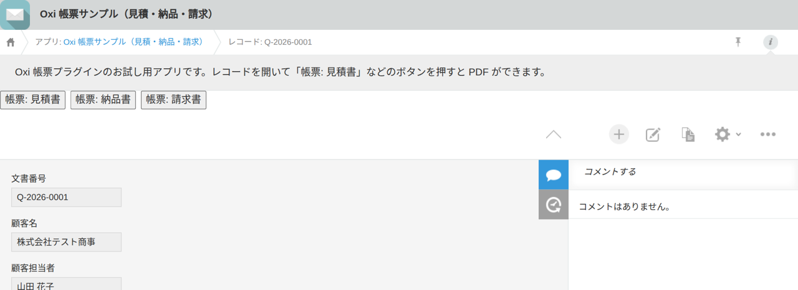
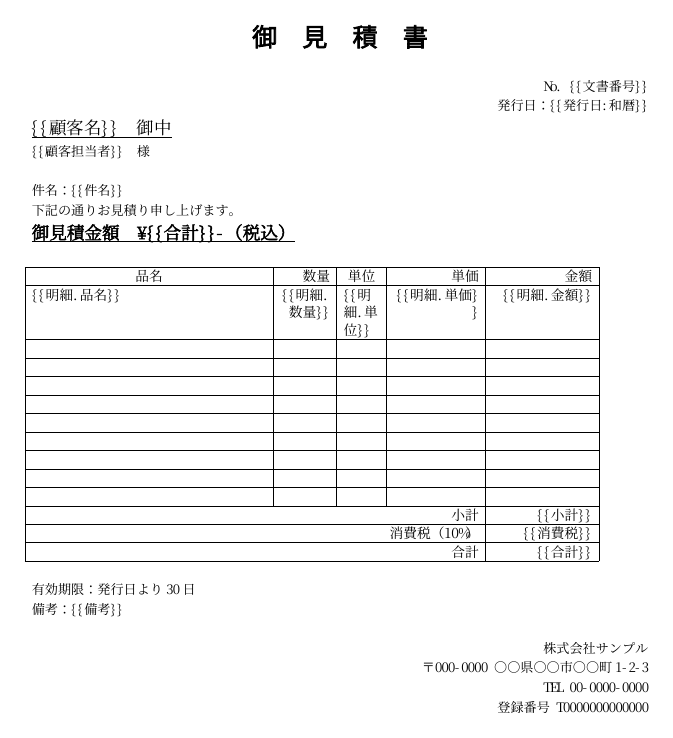
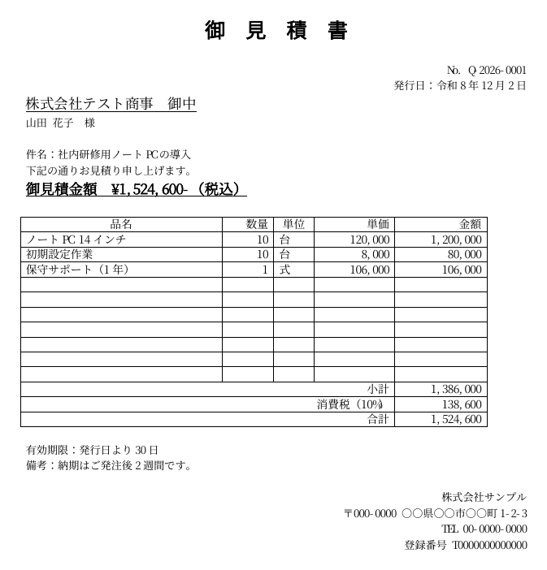
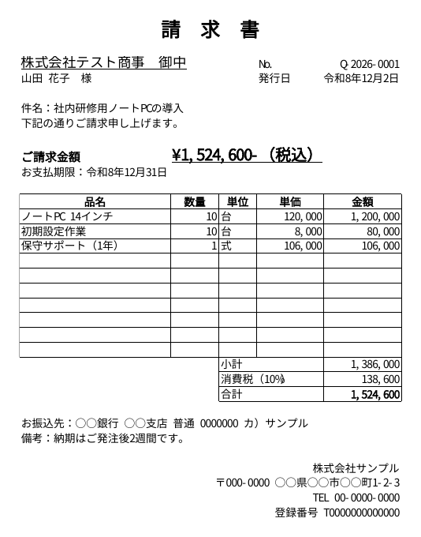
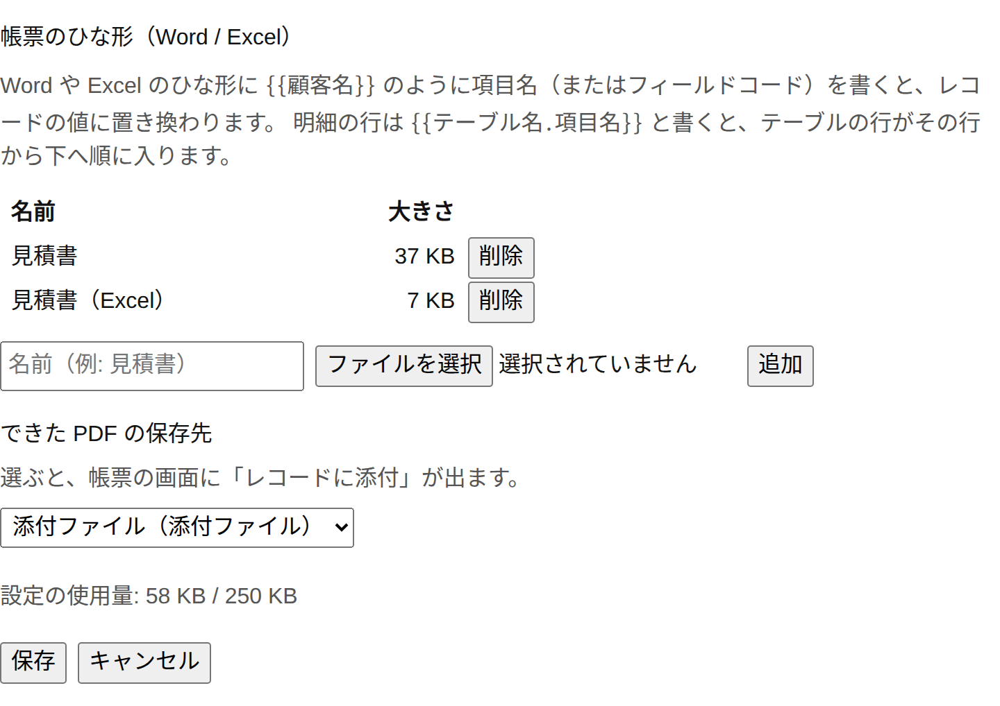

# Oxi 帳票（kintone プラグイン）

Word や Excel で作ったひな形に `{{項目名}}` と書いておくと、kintone のレコードの内容を差し込んだ PDF を作ります。作った PDF は、手元に保存するか、レコードの添付ファイルフィールドに付けられます。



| ひな形（Word） | できあがった PDF |
|---|---|
|  |  |

## 特長

- **Word / Excel のまま編集できます。** 罫線・ロゴ・フォント・表の枠など、見た目はいつもの Word や Excel で整えます。帳票専用の設計ツールを覚える必要はありません。今使っている様式に `{{ }}` を書き足すだけで、ひな形になります。
- **データを外に出しません。** 差し込みも PDF 化も、すべて利用者のブラウザの中で行います。レコードの内容やファイルを、外部のサーバーに送ることはありません。
- **アカウント登録や契約が要りません。** プラグインの zip を読み込むだけで使えます。外部サービスの ID も、API トークンの発行も不要です。
- **特別なブラウザ機能に頼りません。** WebAssembly が動く普通のブラウザで動きます。GPU（WebGPU）も不要です。
- **無料・オープンソースです。** 1 枚いくら、月いくらの料金はありません。商用でもそのまま使えます（MIT / Apache-2.0）。

## 5 分で試す

[Releases](../../releases) から次の 2 つをダウンロードします。

- `oxi-kintone-plugin-x.y.z.zip`（プラグイン本体）
- `oxi-kintone-sample-app.zip`（お試し用アプリのテンプレート）

1. 「kintone システム管理」→「プラグイン」→「読み込む」で、プラグインの zip を読み込みます。
2. ポータルのアプリ欄の「＋」→「テンプレートファイルを読み込んで作成」で、`oxi-kintone-sample-app.zip` を選んでアプリを作ります。プラグインは追加済みです。
3. アプリの設定 →「プラグイン」→ Oxi 帳票の歯車 →「**サンプルのひな形を追加**」→「保存」→「アプリを更新」の順に進みます。
4. レコードを 1 件登録し（明細を何行か入れてください）、レコードの画面で「帳票: 見積書」「帳票: 請求書」などを押します。

サンプルのひな形（[samples/](samples/)）は、Word で作った見積書・納品書と、Excel で作った請求書です。会社名や住所は Word / Excel で開いて書き換え、設定画面から登録し直してください。

| Excel のひな形から作った請求書 |
|---|
|  |

## できること

| ボタン | 動作 |
|---|---|
| 帳票: ＜ひな形名＞ | プラグイン設定に登録したひな形に、表示中のレコードを差し込んで PDF にします |
| 帳票: ＜添付の .docx / .xlsx＞ | レコードに添付された Word / Excel ファイルをひな形として使います |
| 表示: ＜添付の .docx / .xlsx＞ | 添付されたファイルを、差し込みをせずに PDF で表示します |

PDF の画面には「PDF を保存」と、保存先を設定していれば「レコードに添付」が出ます。

- 添付しても、それまでの添付ファイルは消えません。
- PDF の画面を開いたあとにほかの人がレコードを更新していた場合は、上書きを避けるため添付しません。画面を読み込み直して、もう一度作ってください。
- PDF のファイル名は「ひな形名_レコード番号.pdf」です。PDF ビューアのタイトルにも、ひな形名が出ます。

## 動作環境

| 項目 | 内容 |
|---|---|
| kintone | プラグインが使えるコース（スタンダードコース・ワイドコース）。ライトコースではプラグインを使えません。 |
| 画面 | PC 版のレコード詳細画面。スマートフォン版の画面には、ボタンは出ません。 |
| ブラウザ | WebAssembly が動く最新のブラウザ。動作確認は PC 版の Chrome で行っています。 |
| 通信 | 初回のみ、変換エンジン（約 24MB）を unpkg からダウンロードします（下記）。 |

## インストール

1. [Releases](../../releases) から `oxi-kintone-plugin-x.y.z.zip` をダウンロードします。
2. kintone の「kintone システム管理」→「プラグイン」→「読み込む」で zip を選びます。
3. 使うアプリの「アプリの設定」→「プラグイン」→「プラグインを追加する」で「Oxi 帳票」を追加します。
4. 歯車のアイコンから設定を開き、ひな形の名前と Word（.docx）または Excel（.xlsx）のファイルを登録します。PDF をレコードに付けたい場合は、「できた PDF の保存先」で添付ファイルフィールドを選びます。
5. 「保存」→「アプリを更新」で完了です。



新しいバージョンに更新するときは、同じ手順で zip を読み込み直してください。登録したひな形と設定はそのまま残ります。

## ひな形の書き方

Word の文書や Excel のセルに、フィールドの**フィールド名**か**フィールドコード**を `{{ }}` で囲んで書きます。

```
{{顧客名}} 御中
件名：{{件名}}
```

### 早見表

| 書き方 | 入るもの | 例 |
|---|---|---|
| `{{顧客名}}` | フィールドの値 | 株式会社テスト商事 |
| `{{明細.品名}}` | サブテーブルの各行の値（表の行に書く） | ノートPC 14インチ |
| `{{発行日:和暦}}` | 日付を和暦で | 令和8年12月2日 |
| `{{発行日:年月日}}` | 日付を「年月日」で | 2026年12月2日 |
| `{{合計[-1]}}` | 末尾から 1 文字目（1 マス 1 文字の欄） | 0 |
| `{{登録番号[1]}}` | 先頭から 1 文字目 | T |

### 明細（サブテーブル）

表の 1 行に `{{サブテーブル名.フィールド名}}` を書くと、その行から下へサブテーブルの行が入ります。

| 品名 | 数量 | 金額 |
|---|---|---|
| `{{明細.品名}}` | `{{明細.数量}}` | `{{明細.金額}}` |
| | | |
| | | |

- Word では、すぐ下に空の行があると、そこから順に埋めます。行が足りるうちは表の高さが変わらないので、「明細は 10 行」のような決まった枠の帳票でもそのまま使えます。行が足りなくなると、行を足して続けます。
- Excel では行を挿入しません（下にある数式や結合セルがずれるため）。印刷したい行数ぶんの枠を用意してください。入りきらなかった件数は画面に表示されます。

### 1 マスに 1 文字の欄

金額の桁ごとのマスや、インボイスの登録番号の欄のように、1 マスに 1 文字ずつ入れる様式では、何文字目かを `[ ]` で指定します。

- `{{登録番号[1]}}` … 先頭から 1 文字目
- `{{合計[-1]}}` … 末尾から 1 文字目（金額の「円」の位）。`[-2]` が「拾」の位です。

区切りのカンマは数えません。

### 日付

日付フィールドは、そのままだと `2026-11-17` の形で入ります。書式を付けられます。

- `{{請求日:和暦}}` → 令和8年11月17日（元年は「元年」と書きます）
- `{{請求日:年月日}}` → 2026年11月17日

### Excel のひな形

書き方は Word と同じです。Excel ならではの点は次のとおりです。

- セルに `{{金額}}` だけを書くと、数値は**数値のまま**入ります。セルの表示形式（`#,##0`、`"¥"#,##0` など）がそのまま効きます。文章の途中に書いた場合は、カンマ付きの文字として入ります。
- `=SUM(E10:E21)` のような数式は、差し込んだあとに計算し直されます。
- 印刷範囲を設定しておくと、その範囲が PDF になります。用紙の向きや余白、「1 ページに収める」などのページ設定も反映されます。
- 長い文字は、Excel と同じように隣の空いたセルへはみ出して表示されます。

### その他

- 数値と計算のフィールドは、Word では 3 桁ごとにカンマを付けて入ります（`1,386,000`）。
- ユーザー選択や組織選択など、複数の値を持つフィールドは「、」でつないで入ります。
- Word では、テキストボックスの中にも書けます。
- 見つからないフィールド名は `{{ }}` のまま残り、画面に「見つからない項目」として表示されます。

## データの流れとセキュリティ

```text
 kintone（レコード・ひな形・添付ファイル）
        │ kintone の REST API（ログイン中の利用者の権限で）
        ▼
 利用者のブラウザ ── 差し込み・レイアウト・PDF 化（すべてここで完結）
        │
        ├─ 初回のみ：変換エンジンのプログラムを unpkg（npm の公開配信）から取得
        └─ 珍しい書体を使う文書のときだけ：その書体の文字幅の数値を jsDelivr から取得
```

- ブラウザが外部と通信するのは、**変換エンジンのプログラムと、書体の文字幅の数値を取得するとき**だけです。レコードのデータ、ひな形、作った PDF を、外部に送ることはありません。
- エンジンは npm で公開している [`@oxidocs/wasm`](https://www.npmjs.com/package/@oxidocs/wasm) で、バージョンを固定して読み込みます。ブラウザのキャッシュに入るので、2 回目からはダウンロードしません。
- HG 明朝や UD デジタル教科書体など、よく使う書体以外の書体の文字幅は、文書がその書体を使うときだけ [`@oxidocs/wasm-fonts`](https://www.npmjs.com/package/@oxidocs/wasm-fonts) から、その書体の分（数十〜百数十 KB）を取り寄せます。取り寄せるのは文字幅の数値だけで、文書の内容は送りません。
- レコードの読み書きは、kintone の画面を開いている利用者の権限で行います。閲覧できないフィールドや、編集できないレコードを、プラグインが読み書きすることはありません。
- ひな形のファイルは、kintone のプラグイン設定の中に保存されます。

## よくある質問

**Q. 帳票の連携サービスと何が違いますか？**
A. 一般的な帳票サービスは、レコードのデータを外部のサーバーに送って PDF を作ります。Oxi 帳票は、PDF を作る処理までブラウザの中で行うので、データが kintone と利用者の PC の外に出ません。また、ひな形は専用の設計ツールではなく、Word / Excel で作ります。

**Q. 本当に無料ですか？ 会社で使っても大丈夫ですか？**
A. 無料です。MIT / Apache-2.0 のオープンソースなので、商用でもそのまま使えます。

**Q. フォントはどうなりますか？**
A. 日本語は、エンジンに同梱したゴシック体と明朝体で描きます。ＭＳ 明朝、游ゴシックなどを指定したひな形は、近い字形のフォントに置き換わります。Calibri や Arial などの欧文フォントも、幅の同じフォントに置き換えて描きます。PDF には、使った文字だけを埋め込むので、1 ページの帳票で数十 KB 程度です。

**Q. Word で作ったときと、見た目は同じになりますか？**
A. できるだけ近づけていますが、完全に同じではありません。改行の位置やページの区切りが Word とずれることがあります。崩れる帳票があれば、[Issues](../../issues) で教えてください。

**Q. 一覧画面から、複数のレコードをまとめて PDF にできますか？**
A. 今はレコード詳細画面から 1 件ずつです。一覧からの一括出力は、今後の予定に入っています。

**Q. ヘッダーやフッターに差し込めますか？**
A. 今はできません。本文とテキストボックスに書いてください。

## うまくいかないとき

| 症状 | 確認すること |
|---|---|
| ボタンが出ない | プラグインの設定を保存したあと、「アプリを更新」を押したか。レコードの**詳細画面**を開いているか（一覧画面や編集画面には出ません）。 |
| 初回の表示に時間がかかる | 変換エンジン（約 24MB）をダウンロードしています。2 回目からは速くなります。 |
| 「見つからない項目」と出る | `{{ }}` の中のフィールド名・フィールドコードが合っているか。サブテーブルの項目は `{{テーブル名.フィールド名}}` と書いているか。 |
| `{{顧客名}}` が置き換わらない | 一部だけ書式が違っていても置き換わりますが、`{{` と `}}` の間に改行や別の記号が入っていると認識しません。 |
| 「レコードに添付」が出ない | 設定の「できた PDF の保存先」で、添付ファイルフィールドを選んでいるか。 |
| 「更新されたため、添付していません」と出る | 画面を開いたあとにレコードが更新されています。画面を読み込み直してから作り直してください。 |
| Excel の数式の結果が空欄になる | プログラムで作った Excel ファイルには、数式の計算結果が保存されていないことがあります。Excel か LibreOffice で一度開いて保存し直してください。 |
| 設定の上限（256KB）を超える | 画像の大きいひな形は、レコードに添付して「帳票: ＜添付ファイル＞」で使えます。 |

## 今後の予定

- 一覧画面から、複数レコードをまとめて PDF にする
- 変換エンジンを社内のサーバーに置いて使う（インターネットに出られない環境向け）
- 出力ファイル名のルールを設定できるようにする
- PDF ではなく、差し込んだ Word / Excel ファイルのまま保存する

ご要望は [Issues](../../issues) へどうぞ。

## 変換エンジン

変換には [Oxi](https://github.com/Ryujiyasu/oxi) を使っています。Word / Excel / PowerPoint 互換のレイアウトをブラウザの中で行う、Rust 製のオープンソースの文書エンジンです。Word が出力した PDF と見比べる、ブラインドの精度測定を続けています。

## 開発者向け

```text
lib/                 プラグインのソース（差し込み・設定・画面）
  oxi-fill.js        Word の差し込み（docx_to_model → 置換 → docx_from_model）
  oxi-fill-xlsx.js   Excel の差し込み（parse_spreadsheet → 置換 → 再計算 → edit_xlsx_from_workbook）
  plugin-main.js     レコード画面のボタンと PDF の画面
  config-*.js        設定画面
src/                 プラグインの中身（build.sh が src/js を生成）
samples/             お試し用アプリとひな形
test/                Node と Playwright による試験
```

- `./build.sh 0.9.2` で `src/js/` を作ります（引数は `@oxidocs/wasm` のバージョン）。
- `./pack.sh` で署名付きの zip を作ります（秘密鍵は環境変数 `KEY` で指定）。
- `node samples/try.mjs <@oxidocs/wasm のフォルダ> <出力先>` で、kintone の外でひな形を試せます。

## ライセンス

MIT または Apache-2.0 のいずれかを選んでお使いいただけます（[LICENSE-MIT](LICENSE-MIT)、[LICENSE-APACHE](LICENSE-APACHE)）。
